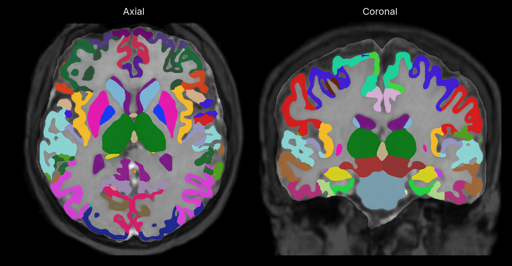

<div align="center">

# synthseg-mlx

Segment brain MRI or CT with SynthSeg in native MLX. Includes cortical parcellation, structure volumes and QC scores.

[](https://pypi.org/project/synthseg-mlx/)
[](https://pypi.org/project/synthseg-mlx/)
[](https://github.com/MedMLX/synthseg-mlx/blob/v0.3.5/LICENSE)
[](https://github.com/ml-explore/mlx)
[](https://huggingface.co/MedMLX/synthseg-mlx)
[](https://github.com/MedMLX/medmlx)

[Model weights](https://huggingface.co/MedMLX/synthseg-mlx) · [MedMLX](https://github.com/MedMLX/medmlx)



</div>

| Input | Output |
| :--- | :--- |
| 3D brain MRI or CT · NIfTI | Brain labels, volumes and QC |

Weights: 424 MB download. Peak MLX memory: 11.6 GB for a 160×192×192 T1 MRI with cortical parcellation.

## Use with MedMLX

Use the [MedMLX MCP server](https://github.com/MedMLX/medmlx/blob/main/docs/mcp.md) to run `synthseg` from an MCP client. Weights download on first use.

```sh
uv tool install --python 3.13 "medmlx[segment,mcp]"
MEDMLX="$(uv tool dir --bin --color never)/medmlx"
mkdir -p "$HOME/medmlx-work"
claude mcp add --scope user medmlx -- "$MEDMLX" serve --root "$HOME/medmlx-work"
```

For Codex, use `codex mcp add medmlx -- "$MEDMLX" serve --root "$HOME/medmlx-work"`. Other MCP clients take the same command and arguments. The same install provides the `medmlx` CLI, for example `medmlx describe synthseg`.

## Install

```bash
uv venv --python 3.13
source .venv/bin/activate
uv pip install "synthseg-mlx>=0.3.5"
```

## Run

```python
from synthseg_mlx.medmlx import run

result = run(image_path="brain.nii.gz", output_dir="out")
print(result["outputs"]["mask"])
```

Omitting `weights_path` downloads `MedMLX/synthseg-mlx` into the shared MedMLX cache on
first use. With MedMLX
installed, `medmlx setup synthseg` downloads it ahead of time. To use your own copy,
pass a folder containing `synthseg_2.0.safetensors`, `synthseg_parc_2.0.safetensors` and
`synthseg_qc_2.0.safetensors` as `weights_path`.

Inputs are resampled to 1 mm if any voxel size differs from 1 mm by more than
0.05 mm; otherwise the input grid is kept. The mask shares its grid with
`resampled_input.nii.gz`.

### Inputs and outputs

| Argument | Meaning |
| --- | --- |
| `image_path` | One 3D brain MRI in NIfTI (`.nii` or `.nii.gz`) of any contrast and resolution, or a CT in Hounsfield units with `ct=True` |
| `output_dir` | Directory for the outputs; created if missing |
| `weights_path` | Optional folder of native safetensors files (see below) |
| `ct` | `False` by default; `True` clips intensities to 0–80 before normalization |
| `robust` | `False` by default; `True` runs the SynthSeg-robust cascade. Implies `fast`; cannot be combined with `v1` |
| `fast` | `False` by default; `True` skips left/right averaging and per-class topology cleanup |
| `v1` | `False` by default; `True` uses SynthSeg 1.0 and omits total intracranial volume. Combines with `fast` |
| `crop` | `None` by default; one or three sizes in voxels (RAS order, rounded up to multiples of 32) bounding the processed patch, as upstream `--crop`. It also replaces the 128-voxel minimum padding |
| `parc` | `True` by default; `False` keeps plain cortex labels 3 and 42 in the mask and volumes |
| `save_posteriors` | `False` by default; `True` also writes `posteriors.nii.gz`, as upstream `--post` |
| `overwrite` | `False` by default; existing outputs are never replaced |
| `arithmetic_profile` | `"source-fp32"` (default) keeps each variant's arithmetic; `"compensated-fp32"` uses compensated Metal operators for the standard model and smooths each prediction before averaging |

Upstream turns parcellation off by default; this runner turns it on. The
parcellation network runs either way, and QC scores the same segmentation output
with or without `parc`, unlike upstream's QC without `--parc`.

Images must be finite, non-constant and 3D, with at least three voxels per axis,
millimetre or unspecified spatial units, header voxel sizes that match the affine,
and orthogonal axes (rotation is fine). A last axis of three voxels is rejected; four
to ten voxels gives a warning, and padding can fail if that axis stays ten voxels or
fewer after preprocessing.

| Output | File | Content |
| --- | --- | --- |
| `mask` | `mask.nii.gz` | int32 FreeSurfer labels; cortex replaced by Desikan-Killiany parcels 1001–1035 and 2001–2035 unless `parc=False` |
| `resampled_input` | `resampled_input.nii.gz` | The input on the mask's grid, or a copy when no resampling was needed |
| `volumes` | `volumes.csv` | Soft volumes in mm³; total intracranial volume comes first, except for v1 |
| `qc_scores` | `qc.csv` | Eight regional QC scores from 0 to 1 |
| `posteriors` | `posteriors.nii.gz` | float32 per-label probabilities on the mask's grid; only with `save_posteriors=True` |

`run` returns `{"outputs": {...}, "details": {...}}`, with run metadata in `details`.
Invalid images, options or existing outputs raise `InvalidInputError`; missing or
incompatible checkpoints raise `AssetNotReadyError`.

### Local weights

Download the converted [SynthSeg weights](https://huggingface.co/MedMLX/synthseg-mlx)
and run:

```python
from huggingface_hub import snapshot_download
from synthseg_mlx.medmlx import run

weights = snapshot_download(
    "MedMLX/synthseg-mlx",
    revision="b4fa99020571cd5921f2205834dd5028fa804046",
    allow_patterns=["synthseg_2.0.safetensors", "synthseg_parc_2.0.safetensors",
                    "synthseg_qc_2.0.safetensors"],
)
result = run(image_path="brain.nii.gz", weights_path=weights, output_dir="out")
print(result["outputs"]["mask"])
```

For `robust` use `synthseg_robust_2.0.safetensors`, and for `v1`
`synthseg_1.0.safetensors`, in place of `synthseg_2.0.safetensors`. Every variant
also needs the parcellation and QC files, even with `parc=False`.

### Python API

The array functions read and write no files. Load the image yourself and pass the
loader's squeezed array (`loaded_image`), `affine` and voxel sizes
(`image_resolution`) without recasting; `models_dir` is the weights folder as a `Path`.

```python
import numpy as np
from synthseg_mlx import (
    SynthSegModel, SynthSegVariant, get_flip_indices, load_label_data, postprocess_arrays,
    predict_numpy, preprocess, qc_scores,
)

variant = SynthSegVariant.STANDARD  # or FAST, ROBUST, V1, V1_FAST
options = dict(robust=variant.robust, fast=variant.fast, v1=variant.v1)
assets = load_label_data(v1=variant.v1, robust=variant.robust)
if variant.fast:
    labels_segmentation, unique_idx = np.unique(assets["segmentation"], return_index=True)
    flip_indices = None
else:
    labels_segmentation, flip_indices, unique_idx = get_flip_indices(
        assets["segmentation"], variant.neutral_labels,
    )
labels_parcellation = np.unique(assets["parcellation"])

model = SynthSegModel.from_safetensors(
    models_dir / variant.segmentation_checkpoint, labels_segmentation,
    models_dir / "synthseg_parc_2.0.safetensors", labels_parcellation,
    models_dir / "synthseg_qc_2.0.safetensors", assets["qc"][unique_idx], flip_indices,
    labels_denoiser=np.unique(assets["denoiser"]) if variant.robust else None,
    **options,
)
image, affine, image_resolution, shape, pad_idx, crop_idx = preprocess(
    loaded_image, affine, image_resolution, ct=False, crop=None, min_pad=128,
)
segmentation, parcellation, raw_qc = predict_numpy(model, image)
label_map, posteriors, volumes = postprocess_arrays(
    segmentation, parcellation, shape=shape, pad_idx=pad_idx, crop_idx=crop_idx,
    labels_segmentation=labels_segmentation, labels_parcellation=labels_parcellation,
    affine=affine, image_resolution=image_resolution,
    topology_classes=assets["topology_classes"][unique_idx], **options,
)
quality = qc_scores(raw_qc, **options)
```

Pass the same variant flags to loading, the model, postprocessing and `qc_scores`.
`preprocess` keeps upstream resampling, RAS alignment, cropping, CT clipping,
normalization and padding; an optional `on_resample(image, affine)` hook sees the
resampled image. `predict_numpy` takes a padded, normalized NDHWC volume whose
spatial sizes are divisible by 16. `postprocess` keeps the upstream parameter names
and, like upstream, modifies its parcellation input. Inference requires Apple Silicon with Metal.

## License

[Apache-2.0](https://github.com/MedMLX/synthseg-mlx/blob/v0.3.5/LICENSE). See [third-party notices](https://github.com/MedMLX/synthseg-mlx/blob/v0.3.5/THIRD_PARTY_NOTICES.md). Model weights retain their publisher terms.
